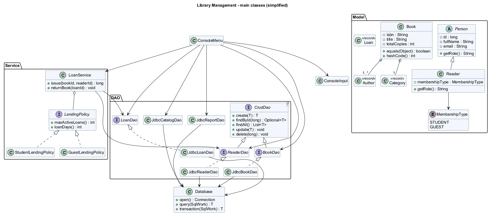

# Архитектура и ООП

Исходник: [class-diagram.puml](class-diagram.puml). Диаграмма показывает основные классы и связи; DTO, методы доступа и вспомогательные классы опущены для читаемости.

Поток операции: `ConsoleMenu → LoanService → LoanDao → PostgreSQL`. CRUD книг и читателей проходит из меню через интерфейсы DAO: отдельный сервис для простой передачи вызова без правил не нужен. SQL находится только в DAO и слое инициализации БД.

| Принцип | Конкретный пример |
|---|---|
| Инкапсуляция | `Book`, `Person`, `Reader`: закрытые поля, проверка в конструкторе, неизменяемые данные |
| Абстракция | `Person` - abstract class; `CrudDao<T>`, `BookDao`, `ReaderDao`, `LoanDao`, `LendingPolicy` - интерфейсы |
| Наследование | `Reader extends Person`, конструктор вызывает `super(...)` |
| Полиморфизм | `Person.toString()` вызывает переопределённый `Reader.getRole()`; `LoanService` вызывает разные реализации `LendingPolicy` |
| Связь объектов | `Book` содержит `Category` и `List<Author>`; это агрегация, авторы и категории живут отдельно |
| Коллекции / generics | `List<Book>`, `Map<MembershipType, LendingPolicy>`, `CrudDao<T>` |
| equals/hashCode | `Book` сравнивается по неизменяемому ISBN; `record Author/Category` получают согласованные методы автоматически |
| enum | `MembershipType.STUDENT/GUEST` |
| Исключения | `LibraryException` для ожидаемых ошибок; ошибки ввода не завершают меню |
| SRP | `ConsoleInput` читает, модель проверяет собственное состояние, DAO хранит, сервис выбирает правила выдачи |
| OCP / Strategy | Новый алгоритм выдачи оформляется реализацией `LendingPolicy`; алгоритм `LoanService.issue()` не меняется |
| DAO / DIP | Меню использует `BookDao` и `ReaderDao`, `LoanService` зависит от `ReaderDao` и `LoanDao`; реализации передаются через конструктор |

`LendingPolicy` отделяет длительность и лимит от механизма выдачи. Чтобы добавить новый тип читателя, нужно также расширить `MembershipType`, SQL CHECK, регистрацию стратегий и меню; OCP здесь относится к алгоритму сервиса, а не ко всему приложению.

Неизменяемые модели не обязаны иметь сеттеры. При редактировании создаётся новый проверенный объект с существующим ID, затем `DAO.update()` сохраняет его. Список авторов защищён через `List.copyOf()`. `ResultSet` закрывается и преобразуется в объекты внутри DAO.

`Database.transaction()` отключает auto-commit, выполняет операцию и делает commit; при SQL-ошибке или бизнес-исключении выполняет rollback. Книга и все связи с авторами записываются в одной транзакции. Выдача проверяет ограничения и вставляет запись в одной транзакции, после блокировки нужных строк.

Используется обычный JDBC, без Spring и Hibernate. Для небольшой консольной программы короткоживущих соединений достаточно; пул соединений, REST, авторизация и веб-интерфейс в этот проект не включены.
