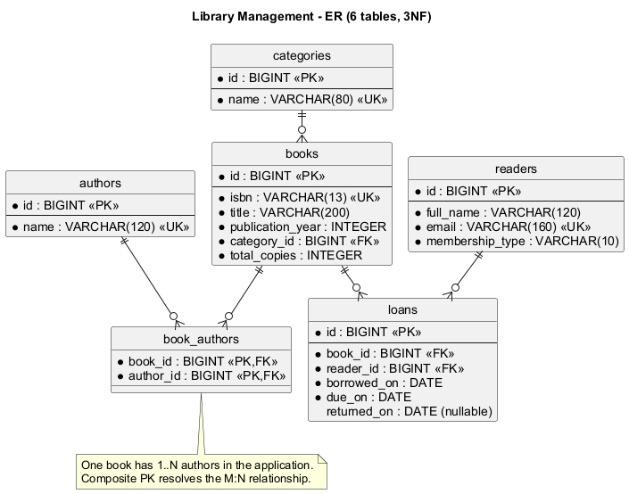

# База данных и нормализация

В БД ровно 6 таблиц приложения; все находятся в схеме `library`.



Исходник: [er-diagram.puml](er-diagram.puml).

| Таблица | Ключи и зависимости |
|---|---|
| `authors` | `id → name`; имя уникально в упрощённом каталоге |
| `categories` | `id → name`; название категории уникально |
| `books` | `id → isbn, title, publication_year, category_id, total_copies`; ISBN тоже кандидатный ключ |
| `book_authors` | составной PK `(book_id, author_id)`; неключевых полей нет |
| `readers` | `id → full_name, email, membership_type`; email тоже кандидатный ключ |
| `loans` | `id → book_id, reader_id, borrowed_on, due_on, returned_on` |

**1NF.** В ячейках атомарные значения. Авторы не хранятся списком в строке книги: для них используется таблица связей.

**2NF.** У всех таблиц с атрибутами одноатрибутный PK; в таблице с составным PK нет неключевых атрибутов, зависящих от части ключа.

**3NF.** Названия авторов и категорий находятся в собственных таблицах. Имя и email читателя не копируются в выдачу. Неключевые поля не определяют другие неключевые поля при принятых правилах предметной области. `due_on` - зафиксированный срок конкретной выдачи; он сохраняется при последующем изменении типа читателя и не считается вычисляемым атрибутом текущего читателя.

`total_copies` - число взаимозаменяемых экземпляров одного издания. Остаток не хранится: его вычисляют по активным выдачам. Проект не отслеживает отдельные инвентарные номера, филиалы, потери и списания экземпляров; для этого потребовалась бы дополнительная сущность экземпляра.

Связи:

- `categories 1:N books`.
- `books M:N authors` через `book_authors`.
- `books 1:N loans`, `readers 1:N loans`.

Внешние ключи запрещают удалить книгу или читателя с историей. При удалении книги без выдач каскадно удаляются только строки её связей с авторами; сами авторы сохраняются. `CHECK` ограничивает даты, число экземпляров, год и тип читателя. Частичный уникальный индекс запрещает две активные выдачи одной книги одному читателю.

Правила «свободные экземпляры» и «лимит читателя» затрагивают несколько строк, поэтому выполняются транзакционно в DAO, а не обычным `CHECK`. Выдача блокирует строку читателя, затем строку книги с помощью `FOR UPDATE`; параллельные выдачи через приложение повторно проверяют актуальные значения после ожидания. Изменение фонда блокирует ту же строку книги. Прямые ручные INSERT в обход приложения не проверяют лимит и количество экземпляров: для рабочего многопользовательского сервера доступ на запись нужно ограничивать либо переносить эти проверки в процедуру/триггер.

Для поиска используется `ILIKE` с параметрами и экранированием `%`, `_`, `!`: введённые символы ищутся буквально. Небольшой учебный каталог не требует полнотекстового индекса. Индексы внешних ключей и частичный индекс просрочек помогают связанным операциям.

## Пример JOIN и агрегата

```sql
SELECT b.id, b.title, count(l.id) AS loan_count
FROM library.books b
LEFT JOIN library.loans l ON l.book_id = b.id
GROUP BY b.id, b.title
ORDER BY loan_count DESC, b.title, b.id;
```

`LEFT JOIN` оставляет книги без выдач, `count(l.id)` для них возвращает 0. `count(*)` вернул бы 1, что было бы ошибкой. В статистике категорий выдачи агрегируются до соединения с книгами, иначе несколько выдач умножили бы `total_copies`.
