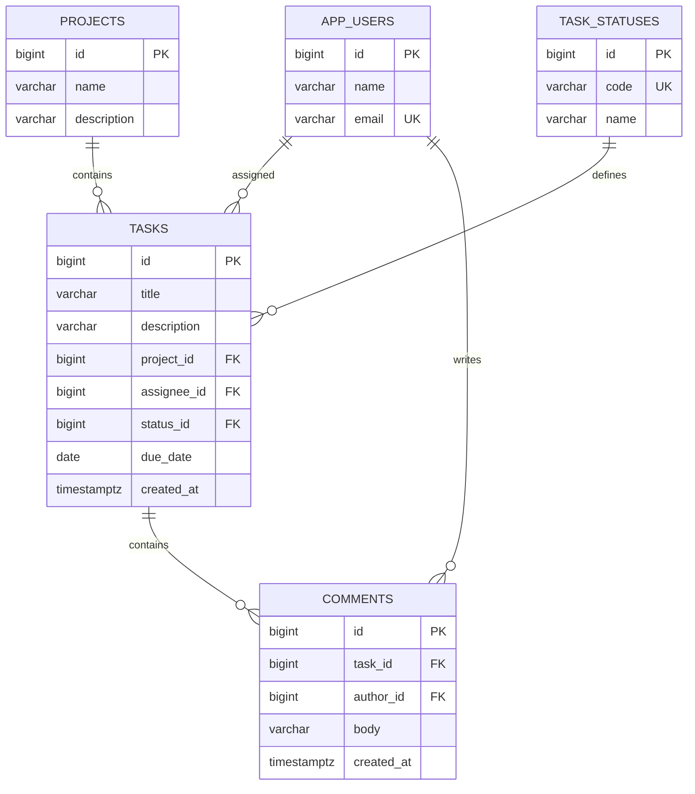
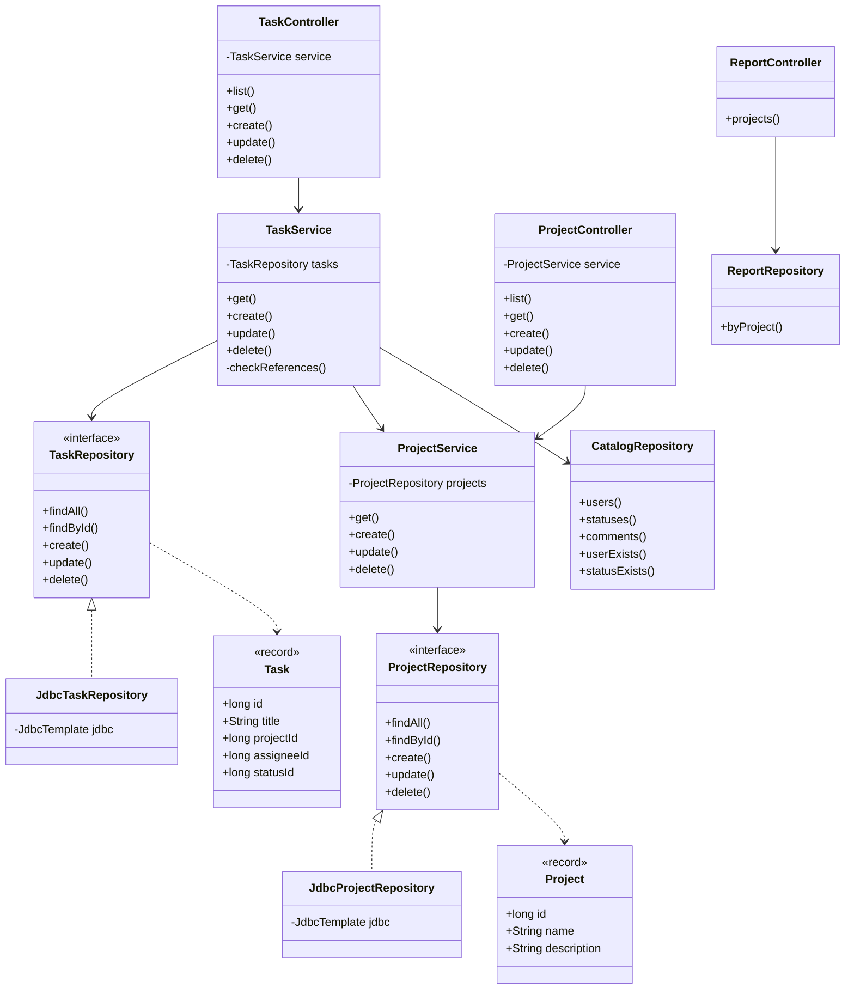

# Диаграммы

GitHub отображает эти диаграммы прямо в браузере, в том числе на телефоне.

## ER

Удаление задачи каскадно удаляет комментарии. Удаление связанных проекта, пользователя или статуса ограничено FK.

## Основные классы

Показаны основные зависимости. DTO, вспомогательные модели и часть полей Task опущены для читаемости.
